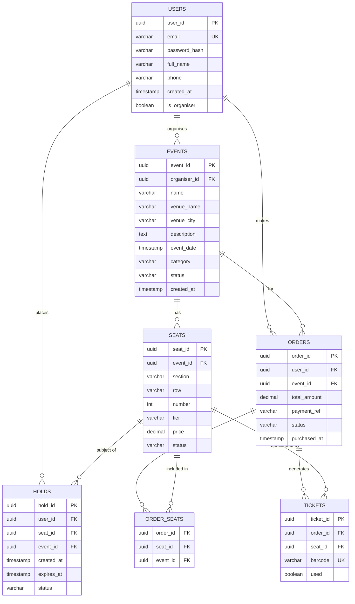
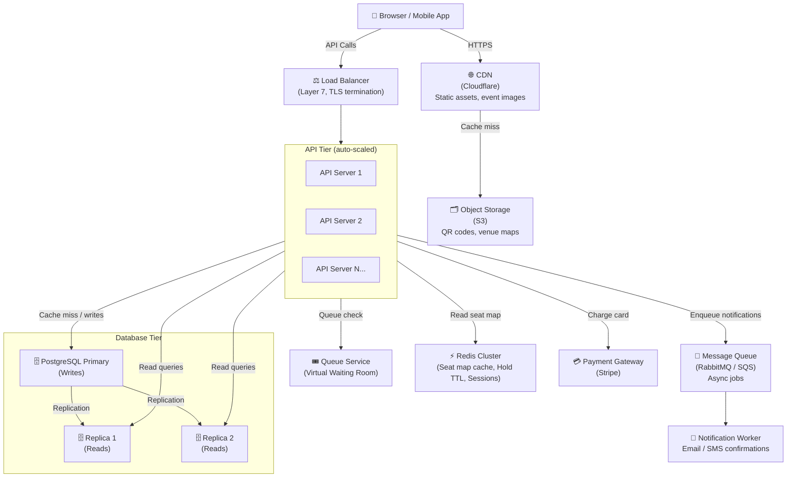

# TicketHub — System Design Document

> A website that sells tickets for concerts and events.

---

## Part 1 — Requirements

### Functional Requirements

| # | Requirement |
|---|-------------|
| FR-1 | Users can register, log in, and manage their accounts. |
| FR-2 | Users can browse upcoming events (concerts, shows, sports, etc.). |
| FR-3 | Users can view the seating map for a specific event and see which seats are available, held, or sold. |
| FR-4 | Users can place a **temporary hold** on one or more seats (hold lasts 10 minutes). |
| FR-5 | Users can complete a purchase within the hold window by providing payment details. |
| FR-6 | Users can view their order history and download/display their tickets (with QR code). |
| FR-7 | Expired holds are automatically released so seats become available again. |
| FR-8 | Organisers can create events, upload seating maps, and set prices per seat tier. |
| FR-9 | The system sends email/SMS confirmations after a successful purchase. |

### Non-Functional Requirements

#### Speed
| Metric | Target |
|--------|--------|
| Event browsing page | ≤ 200 ms (p99) under normal load |
| Seat map load | ≤ 500 ms (p99) under normal load |
| Hold seat API | ≤ 300 ms (p95) |
| Payment confirmation | ≤ 3 s end-to-end (p95) |
| Ticket display page | ≤ 300 ms (p99) |

#### Correctness (Double-Booking Prevention)
- **No two users may ever own the same seat for the same event.** This is enforced at the database level — not just application logic — using a **unique constraint** on `(event_id, seat_id)` in the `orders` table and a row-level lock (`SELECT FOR UPDATE`) during the hold flow.
- Holds that expire must be released atomically so another user can claim the seat without a race condition.

#### Fairness
- During high-demand sales, a **virtual queue** admits users at a controlled rate (e.g., 2,000 users per minute) rather than letting the fastest network connection win.
- Hold duration is capped at **10 minutes** for all users equally; no user can hoard seats indefinitely.
- Bot protection (CAPTCHA + rate limiting) prevents automated buyers from monopolising inventory.

#### Availability & Durability
- Target **99.9 % uptime** (≤ 8.7 hours downtime/year).
- All completed orders are persisted durably; no confirmed ticket may be silently lost.
- The system must survive a single availability-zone failure with no data loss.

#### Scalability
- Support **2 million registered users**.
- Handle normal daily load of **50,000 concurrent-session users**.
- Handle the **big-sale peak** (200,000 concurrent users in 10 minutes) without data corruption.

---

## Part 2 — Estimates

### Normal Day

| Parameter | Value | Derivation |
|-----------|-------|------------|
| Daily active users (DAU) | 50,000 | Given |
| Pages viewed per user | 10 | Given |
| Total page views/day | 500,000 | 50,000 × 10 |
| Duration of active session | ~8 hours of peak spread | Assumed |
| Peak-hour multiplier | ~4 × average | Standard web heuristic |
| Average RPS (all day) | **~6 RPS** | 500,000 / 86,400 s |
| Peak RPS (busiest hour) | **~24 RPS** | 6 × 4 |
| Tickets sold/day | 5,000 | Given |
| Write RPS (purchases) | **~0.06 RPS** | 5,000 / 86,400 s |

> Normal load is light — a modest cluster of application servers and a single primary database handle this comfortably.

---

### Big-Sale Peak

| Parameter | Value | Derivation |
|-----------|-------|------------|
| Concurrent buyers | 200,000 | Given |
| Window | 10 minutes (600 s) | Given |
| Seats available | 20,000 | Given |
| Total requests in window | ~2,000,000 | 200,000 users × ~10 requests each (browse, queue poll, hold, pay) |
| Peak RPS | **~3,333 RPS** | 2,000,000 / 600 s |
| Hold/buy write RPS | **~33 RPS** | 20,000 seats / 600 s |

### Comparison

| Dimension | Normal Day | Big-Sale Peak | Ratio |
|-----------|-----------|---------------|-------|
| Read RPS | ~24 | ~3,333 | **~139×** |
| Write RPS | ~0.06 | ~33 | **~550×** |
| Concurrent users | ~50,000 | ~200,000 | **~4×** |

The big sale is **~139× heavier on reads** and **~550× heavier on writes** than a normal day. This drives the need for caching, queue-based admission, and a scaled-out database tier during peak events.

---

## Part 3 — API Design

All endpoints are versioned (`/api/v1/`) and return JSON. Authentication uses JWT Bearer tokens.

### Endpoint Table

| # | Method | Path | Auth | Description |
|---|--------|------|------|-------------|
| 1 | `GET` | `/api/v1/events` | Public | Browse/search events |
| 2 | `GET` | `/api/v1/events/{event_id}/seats` | Public | View seat map & availability |
| 3 | `POST` | `/api/v1/seats/hold` | Required | Place a temporary hold on selected seats |
| 4 | `POST` | `/api/v1/orders` | Required | Pay and convert hold to confirmed order |
| 5 | `GET` | `/api/v1/orders` | Required | List the authenticated user's orders |
| 6 | `GET` | `/api/v1/orders/{order_id}/tickets` | Required | Get ticket detail + QR code for an order |
| 7 | `DELETE` | `/api/v1/seats/hold/{hold_id}` | Required | Release a hold early (user cancels) |
| 8 | `POST` | `/api/v1/queue/join` | Required | Join the virtual queue for a high-demand sale |

---

### Endpoint Details

#### 1. `GET /api/v1/events`
Browse and search events. Results are paginated.

**Query parameters:**

| Param | Type | Description |
|-------|------|-------------|
| `q` | string | Full-text search (artist, venue, city) |
| `date_from` | ISO 8601 date | Filter start date |
| `date_to` | ISO 8601 date | Filter end date |
| `category` | string | `concert`, `sports`, `theatre` |
| `page` | int | Page number (default 1) |
| `limit` | int | Items per page (max 50) |

**Response `200 OK`:**
```json
{
  "data": [
    {
      "event_id": "evt_abc123",
      "name": "Taylor Swift — Eras Tour",
      "venue": "Wembley Stadium",
      "date": "2026-06-14T19:30:00Z",
      "min_price": 75.00,
      "max_price": 350.00,
      "seats_available": 4821,
      "image_url": "https://cdn.tickethub.io/events/evt_abc123.jpg"
    }
  ],
  "pagination": { "page": 1, "limit": 20, "total": 142 }
}
```

---

#### 2. `GET /api/v1/events/{event_id}/seats`
Returns the full seating map with per-seat status.

**Response `200 OK`:**
```json
{
  "event_id": "evt_abc123",
  "venue_map_url": "https://cdn.tickethub.io/maps/wembley.svg",
  "seats": [
    {
      "seat_id": "seat_A12",
      "section": "A",
      "row": "A",
      "number": 12,
      "tier": "premium",
      "price": 350.00,
      "status": "available"   // available | held | sold
    }
  ]
}
```

> **Caching note:** This response is served from an in-memory cache (Redis) with a **5-second TTL** during normal operation and a **1-second TTL** during big sales. Stale reads are acceptable; the hold API enforces true correctness.

---

#### 3. `POST /api/v1/seats/hold`
Atomically reserves up to 8 seats for 10 minutes.

**Request body:**
```json
{
  "event_id": "evt_abc123",
  "seat_ids": ["seat_A12", "seat_A13"]
}
```

**Response `201 Created`:**
```json
{
  "hold_id": "hold_xyz789",
  "seat_ids": ["seat_A12", "seat_A13"],
  "expires_at": "2026-06-01T10:10:00Z",
  "total_price": 700.00
}
```

**Errors:**

| Code | Meaning |
|------|---------|
| `409 Conflict` | One or more seats already held/sold |
| `400 Bad Request` | More than 8 seats requested |
| `403 Forbidden` | User not yet admitted from queue |

---

#### 4. `POST /api/v1/orders`
Convert a hold into a confirmed order by charging the user.

**Request body:**
```json
{
  "hold_id": "hold_xyz789",
  "payment_method_id": "pm_stripe_tok_abc"
}
```

**Response `201 Created`:**
```json
{
  "order_id": "ord_def456",
  "status": "confirmed",
  "seats": ["seat_A12", "seat_A13"],
  "total_charged": 700.00,
  "confirmation_email": "user@example.com"
}
```

---

#### 5. `GET /api/v1/orders`
List all orders for the authenticated user.

**Response `200 OK`:**
```json
{
  "data": [
    {
      "order_id": "ord_def456",
      "event_name": "Taylor Swift — Eras Tour",
      "event_date": "2026-06-14T19:30:00Z",
      "seats": ["seat_A12", "seat_A13"],
      "status": "confirmed",
      "total": 700.00,
      "purchased_at": "2026-06-01T10:07:32Z"
    }
  ]
}
```

---

#### 6. `GET /api/v1/orders/{order_id}/tickets`
Return ticket detail and a QR code for venue entry.

**Response `200 OK`:**
```json
{
  "order_id": "ord_def456",
  "tickets": [
    {
      "ticket_id": "tkt_001",
      "seat_id": "seat_A12",
      "section": "A", "row": "A", "number": 12,
      "qr_code_url": "https://cdn.tickethub.io/qr/tkt_001.png",
      "barcode": "TH2026A12XYZ"
    }
  ]
}
```

---

#### 7. `DELETE /api/v1/seats/hold/{hold_id}`
Release a hold before it expires.

**Response `204 No Content`**

---

#### 8. `POST /api/v1/queue/join`
Join the virtual waiting queue for a high-demand sale. Returns position and estimated wait time.

**Response `200 OK`:**
```json
{
  "queue_id": "q_abc",
  "position": 14302,
  "estimated_wait_seconds": 430,
  "token": "eyJhbGciOiJIUzI1NiJ9..."
}
```

---

## Part 4 — Data Model

### Entity-Relationship Diagram



---

### Table Definitions

#### `users`
| Column | Type | Constraints |
|--------|------|-------------|
| `user_id` | UUID | PK |
| `email` | VARCHAR(255) | UNIQUE NOT NULL |
| `password_hash` | VARCHAR(255) | NOT NULL |
| `full_name` | VARCHAR(255) | NOT NULL |
| `phone` | VARCHAR(30) | |
| `is_organiser` | BOOLEAN | DEFAULT FALSE |
| `created_at` | TIMESTAMP | DEFAULT NOW() |

---

#### `events`
| Column | Type | Constraints |
|--------|------|-------------|
| `event_id` | UUID | PK |
| `organiser_id` | UUID | FK → users(user_id) |
| `name` | VARCHAR(255) | NOT NULL |
| `venue_name` | VARCHAR(255) | NOT NULL |
| `venue_city` | VARCHAR(100) | NOT NULL |
| `event_date` | TIMESTAMP | NOT NULL |
| `category` | VARCHAR(50) | |
| `status` | VARCHAR(20) | DEFAULT `'draft'` |
| `created_at` | TIMESTAMP | DEFAULT NOW() |

---

#### `seats`
| Column | Type | Constraints |
|--------|------|-------------|
| `seat_id` | UUID | PK |
| `event_id` | UUID | FK → events(event_id) |
| `section` | VARCHAR(20) | NOT NULL |
| `row` | VARCHAR(10) | NOT NULL |
| `number` | INT | NOT NULL |
| `tier` | VARCHAR(50) | (e.g. `'premium'`, `'general'`) |
| `price` | DECIMAL(10,2) | NOT NULL |
| `status` | VARCHAR(20) | DEFAULT `'available'` |

*Unique constraint:* `UNIQUE (event_id, section, row, number)` — ensures no duplicate physical seats.

---

#### `holds`
| Column | Type | Constraints |
|--------|------|-------------|
| `hold_id` | UUID | PK |
| `user_id` | UUID | FK → users(user_id) |
| `seat_id` | UUID | FK → seats(seat_id) |
| `event_id` | UUID | FK → events(event_id) |
| `created_at` | TIMESTAMP | DEFAULT NOW() |
| `expires_at` | TIMESTAMP | NOT NULL |
| `status` | VARCHAR(20) | `'active'` \| `'released'` \| `'converted'` |

*Partial unique index:* `UNIQUE (seat_id) WHERE status = 'active'` — only one active hold per seat at a time.

---

#### `orders`
| Column | Type | Constraints |
|--------|------|-------------|
| `order_id` | UUID | PK |
| `user_id` | UUID | FK → users(user_id) |
| `event_id` | UUID | FK → events(event_id) |
| `total_amount` | DECIMAL(10,2) | NOT NULL |
| `payment_ref` | VARCHAR(255) | |
| `status` | VARCHAR(20) | `'pending'` \| `'confirmed'` \| `'refunded'` |
| `purchased_at` | TIMESTAMP | DEFAULT NOW() |

---

#### `order_seats` (join table)
| Column | Type | Constraints |
|--------|------|-------------|
| `order_id` | UUID | FK → orders(order_id) |
| `seat_id` | UUID | FK → seats(seat_id) |
| `event_id` | UUID | FK → events(event_id) |

*Primary key:* `(order_id, seat_id)` — a seat can only appear once per order.  
*Unique constraint:* `UNIQUE (seat_id, event_id)` — **this is the ultimate double-booking guard**: a seat-event pair can only exist in one confirmed order ever.

---

#### `tickets`
| Column | Type | Constraints |
|--------|------|-------------|
| `ticket_id` | UUID | PK |
| `order_id` | UUID | FK → orders(order_id) |
| `seat_id` | UUID | FK → seats(seat_id) |
| `barcode` | VARCHAR(100) | UNIQUE NOT NULL |
| `used` | BOOLEAN | DEFAULT FALSE |

---

### Relationships Summary

| Relationship | Cardinality | Note |
|---|---|---|
| User → Events | 1-to-many | An organiser creates many events |
| Event → Seats | 1-to-many | Each event has its own seat inventory |
| User → Holds | 1-to-many | A user can hold multiple seats |
| Seat → Holds | 1-to-1 (active) | Only one active hold per seat |
| User → Orders | 1-to-many | A user can buy many orders |
| Order → Seats | many-to-many via `order_seats` | An order covers 1–8 seats |
| Order → Tickets | 1-to-many | One ticket per seat per order |

---

## Part 5 — Architecture

### Diagram



---

### Component Explanations

| Component | Role | Why It's There |
|-----------|------|----------------|
| **CDN (Cloudflare)** | Serves static files (JS, CSS, images, venue maps) from edge nodes globally | Offloads ~80 % of traffic from origin; greatly reduces latency for asset-heavy pages |
| **Load Balancer** | Distributes HTTPS requests across API servers; terminates TLS | Single entry point; enables horizontal scaling of API tier |
| **API Servers (auto-scaled)** | Stateless application logic: routing, auth, business rules | Stateless design means any server can handle any request; scale out by adding replicas |
| **Queue Service (Virtual Waiting Room)** | Manages admission during big sales; issues time-limited tokens | Prevents the database from being slammed by 200,000 simultaneous write attempts; enforces fairness |
| **Redis Cluster** | Caches seat-availability maps (short TTL); stores hold expiry timers; manages user sessions | Absorbs the avalanche of seat-map reads during a sale; atomic `SET NX` commands handle holds without hitting the DB for every request |
| **PostgreSQL Primary** | Single source of truth for all writes (holds, orders) | ACID transactions + row-level locks guarantee correctness and prevent double-booking |
| **PostgreSQL Replicas** | Handle read queries (browse events, view order history) | Scale read throughput horizontally without increasing write load on the primary |
| **Message Queue (RabbitMQ/SQS)** | Buffers async tasks (send email, generate QR code) | Decouples slow I/O (SMTP, S3 upload) from the critical payment path |
| **Notification Worker** | Consumes messages and sends emails/SMS | Runs independently; failures don't affect purchase flow |
| **Payment Gateway (Stripe)** | Processes card payments; handles PCI compliance | Offloads complex payment security to a specialist provider |
| **Object Storage (S3)** | Stores generated QR code images, venue SVG maps | Cheap, durable, globally accessible via CDN |

---

### How the System Survives the Big Sale

1. **Virtual Queue** — Before the sale opens, users join a queue. The system admits ≈ 2,000 users/minute (configurable), giving each a short-lived signed token to call the Hold API. All other users see a waiting-room page and poll their queue position.
2. **Redis for seat availability** — The seat map (large read payload) is cached in Redis with a 1-second TTL. 200,000 users reading the map hit Redis, not PostgreSQL.
3. **Auto-scaling API tier** — CloudWatch (or equivalent) triggers an auto-scaling event 30 minutes before a flagged sale, pre-warming enough server instances.
4. **Database row-level locking** — Only admitted users attempt writes, reducing peak write RPS from a potential 3,333 to the controlled ~33. PostgreSQL handles this comfortably.
5. **Hold expiry** — Redis keyspace events trigger a background job to release holds whose TTL has expired, keeping inventory fresh without polling.

---

## Part 6 — Preventing Double-Booking

Double-booking is prevented by a **layered defence**:

### Layer 1 — Database Unique Constraint (Hard Guarantee)
```sql
-- In the order_seats table:
ALTER TABLE order_seats
  ADD CONSTRAINT uq_seat_per_event UNIQUE (seat_id, event_id);
```
Even if two transactions reach the INSERT simultaneously, PostgreSQL will let only one succeed and reject the other with a unique-constraint violation. This is the **last line of defence** and never relies on application logic alone.

### Layer 2 — Pessimistic Row Lock During Hold
```sql
BEGIN;

-- Lock the seat row so no concurrent transaction can touch it
SELECT * FROM seats
WHERE seat_id = $1 AND event_id = $2 AND status = 'available'
FOR UPDATE;          -- <-- row-level exclusive lock

-- If no row returned → seat is gone; ROLLBACK and return 409
-- Otherwise:
UPDATE seats SET status = 'held' WHERE seat_id = $1;

INSERT INTO holds (hold_id, user_id, seat_id, event_id, expires_at, status)
VALUES (..., NOW() + INTERVAL '10 minutes', 'active');

COMMIT;
```
`SELECT FOR UPDATE` blocks any concurrent transaction from reading the same seat row until this transaction commits or rolls back, eliminating the TOCTOU (time-of-check/time-of-use) race.

### Layer 3 — Partial Unique Index on Holds
```sql
CREATE UNIQUE INDEX uq_active_hold_per_seat
  ON holds (seat_id)
  WHERE status = 'active';
```
Only one active hold may exist for a seat at any moment. This catches the edge case where two transactions both pass the `SELECT FOR UPDATE` at nearly the same nanosecond (not normally possible, but adds safety-in-depth).

### Layer 4 — Redis Atomic Check (First Filter)
Before touching the database at all, the API performs a Redis `SET NX` (set-if-not-exists) on a key like `hold:<event_id>:<seat_id>`. If it fails, the request is rejected immediately — most concurrent users never even reach the database, protecting it from thundering-herd writes.

### Summary Flow
```
User requests Hold
    │
    ├─► Redis SET NX → key already exists? → 409 Conflict (fast path)
    │
    └─► DB Transaction: SELECT … FOR UPDATE
            │
            ├─ seat.status ≠ 'available'? → ROLLBACK → 409 Conflict
            │
            └─ UPDATE seat + INSERT hold → COMMIT
                    │
                    └─ UNIQUE constraint catches any final race → DB-level 409
```

---

## Trade-Offs

### Trade-Off 1 — Eventual Consistency on Seat Map vs. Strong Consistency

**Decision:** The seat map returned by `GET /events/{id}/seats` is served from Redis with a 1-second TTL, meaning it may be slightly stale.

| Aspect | Detail |
|--------|--------|
| **Benefit** | Eliminates up to 200,000 direct database reads per second during a sale; makes browsing fast and cheap |
| **Cost** | A user might see a seat as "available" in the UI but then get a 409 when they try to hold it |
| **Mitigation** | The Hold API always enforces consistency at the database layer. The user sees a friendly error ("Sorry, that seat was just taken — please choose another") and the UI refreshes the map |
| **Verdict** | The slight UX friction is acceptable; correctness is never compromised on the write path |

---

### Trade-Off 2 — Virtual Queue Fairness vs. Simplicity

**Decision:** A virtual waiting room is added for flagged high-demand sales instead of letting all users attempt concurrently.

| Aspect | Detail |
|--------|--------|
| **Benefit** | Protects the database; gives every user (regardless of connection speed) a roughly equal chance based on when they joined the queue |
| **Cost** | Adds an extra service to build and maintain; introduces a new failure point; users may find waiting frustrating |
| **Mitigation** | Queue service is a simple, battle-tested design (randomised shuffle on join, position updates via WebSocket or polling). It can fall back to "first-come-first-served" if it fails, degrading gracefully |
| **Verdict** | Fairness and database protection outweigh the added operational complexity, especially for events with millions of fans competing for 20,000 seats |

---

### Trade-Off 3 — Hold-Then-Pay vs. Pay-At-Once

**Decision:** A **hold-then-pay** model is used (user holds seats, then separately completes payment) rather than reserving and charging in one step.

| Aspect | Detail |
|--------|--------|
| **Benefit** | Separates fast reservation (sub-second, DB write) from slow payment (1–3 s, external API call); lets users review their cart before committing money |
| **Cost** | Seats are locked for up to 10 minutes even if the user abandons; this reduces available inventory during peak windows |
| **Mitigation** | Hold time is intentionally short (10 minutes); a background job aggressively reclaims expired holds and pushes seat availability back to Redis instantly |
| **Verdict** | Industry standard for ticketing (used by Ticketmaster, StubHub); the user experience benefit outweighs the temporary inventory reduction |
